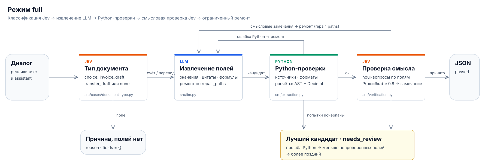
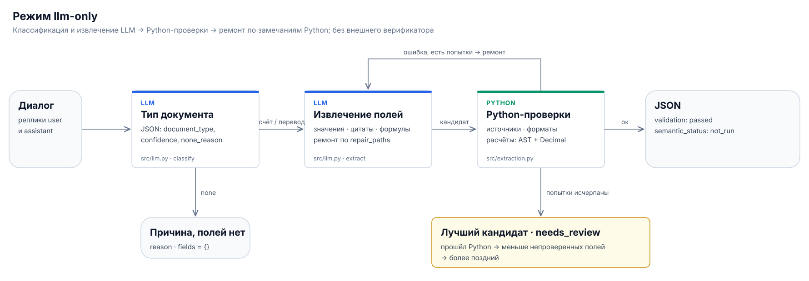

# LLM + Decision-Type Model

**Извлечение полей документов из диалога с проверками и ограниченным исправлением ошибок.**

Проект исследует, помогает ли отдельная **модель принятия решений** повысить качество
заполнения документов генеративной LLM. LLM предлагает значения, цитаты и формулы,
Python проверяет структуру и выполняет расчёты, а decision-type model определяет тип
документа и оценивает возможные смысловые ошибки.

Верификатор — Jev или другая модель решений с TypeSafe-совместимым API.
Извлекающая LLM настраивается независимо — через внешний API или локальный сервер.

[Как это работает](#как-это-работает) · [Быстрый старт](#быстрый-старт) ·
[Выбор верификатора](#выбор-верификатора) · [Данные и результат](#данные-и-результат) ·
[Результаты](#результаты) · [Оценка качества](#оценка-качества) ·
[Требования к итоговому JSON](docs/document-output-contract.md) ·
[Промпты Jev на русском](docs/jev-prompts.md)

## Задача проекта

На входе — переписка пользователя и ассистента: запрос, реквизиты, уточнения,
исправления и отмены. На выходе — JSON с актуальными значениями и ссылками
на сообщения, которые их подтверждают.

| Тип             | Что распознаётся                                                                  |
| ------------------ | ------------------------------------------------------------------------------------------------ |
| `invoice_draft`  | Запрос на подготовку счёта на оплату                              |
| `transfer_draft` | Запрос на перевод пользователя на собственную карту |
| `none`           | Актуального запроса на поддерживаемый документ нет  |

Система учитывает весь диалог. Позднее явное исправление заменяет прежнее значение,
а нехватка реквизитов отражается статусом поля. Источниками фактов служат реплики
пользователя; сообщения ассистента помогают понять контекст ответа.

Результат представляет собой структурированный черновик.

## Как это работает






| Участник              | Ответственность                                                                                                                                                                                                    |
| ----------------------------- | --------------------------------------------------------------------------------------------------------------------------------------------------------------------------------------------------------------------------------- |
| **LLM**                 | Предлагает заполнение полей, точные цитаты и планы вычислений                                                                                                                |
| **Python**              | Проверяет ответ и источники, ограничивает формулы разрешёнными действиями, вычисляет значения и защищает область ремонта |
| **Decision-type model** | Проверяет принадлежность данных, актуальность, пропуски, неоднозначность и смысл расчётов                                                           |

Например, из «5 коробок бумаги общей стоимостью 1000 рублей» LLM может предложить
формулу цены `1000 / 5`. Python вычислит `200`, а верификатор оценит, действительно
ли эти числа относятся к одной позиции и подходят для такого действия.

Вопросы проверки отправляются одним пакетом. Для вопросов типа `noul` высокая
оценка означает **вероятную ошибку**. Оценка не ниже настроенного порога создаёт
замечание для следующей попытки LLM.

Исправления ограничены полем, атрибутом или конкретной частью источника.
При ремонте только недословных цитат модель выбирает готовые фрагменты текста,
а Python копирует их по разрешённым путям. Объединённый кандидат проверяется заново.

По умолчанию разрешены **две попытки извлечения**, включая первую.
После исчерпания попыток возвращается лучший из кандидатов (прошедший Python,
затем с меньшим числом непроверенных полей, при равенстве — более поздний) с
`validation.status = "needs_review"`. В `validation.issues` записываются пути
полей и причины, а сами поля получают `validation_status = "needs_review"`.
Сумма, вычисленная формулой, помечается вместе с позициями счёта, если замечание
относится к ним.
Остальные независимые поля сохраняются и проходят обычную Python-проверку.
Если расчёт выполнить нельзя, его результат остаётся `null`; исходные значения,
цитаты и планы проблемных полей доступны в `validation.unverified_fields`.

При ошибках Python смысловая проверка этого кандидата не запускается:
`semantic_status = "not_run"`. Успешный результат имеет
`validation.status = "passed"`; в режиме `llm-only` смысловая проверка также
помечается `not_run`. Если ни одного структурно пригодного кандидата получить
не удалось, кейс по-прежнему завершается ошибкой. Сбои API также остаются ошибками.

## Результаты

Итоговые эксперименты: Qwen 3.8 27B извлекает поля, Jev (`typesafe/jev-1.14`)
проверяет их в режиме `full`. Каждая выборка прогонялась трижды в каждом режиме,
цены — по тарифам routerai.ru.

|                                                                                   | evaluation50: `llm-only` | evaluation50: `full` | challenge: `llm-only` | challenge: `full` |
| --------------------------------------------------------------------------------- | -------------------------: | ---------------------: | ----------------------: | ------------------: |
| Черновик верен целиком                                        |                      97,3% |                  98,0% |                   94,7% |               97,6% |
| Тихие ошибки (неверный черновик без пометки) |                       2,7% |                   2,0% |                    5,3% |                1,4% |
| Верен во всех трёх прогонах                                |                      96,0% |                  98,0% |                   92,8% |               97,1% |
| Стоимость прогона                                                 |                 49 руб. |             55 руб. |              32 руб. |          60 руб. |
| Время прогона                                                         |                  59 мин |              51 мин |              105 мин |          105 мин |

На простых диалогах evaluation50 оба режима почти не ошибаются. На сложных
диалогах challenge `full` сокращает тихие ошибки почти вчетверо, и это снижение
статистически значимо; прирост точности целиком значимым не оказался. Jev не пометил
как ошибочное ни одного верного поля. Цены между выборками напрямую не сравниваются:
evaluation50 шёл через другого провайдера.

Jev в роли проверяющего сравнивался с языковыми моделями на 53 черновиках
challenge с 16 реальными ошибками: Jev нашёл 15 без ложных замечаний, Qwen 3.8 27B —
14, DeepSeek V4 Pro — 16, но проверка через DeepSeek примерно в 30 раз дороже
(4,3 руб. против 0,14 руб. за черновик).

Подробности, доверительные интервалы и ограничения — в локальных отчётах
`docs/experiment-report-2026-11-03.md`, `docs/experiment-report-challenge-2026-11-04.md`
и `docs/experiment-results.pdf`; протокол — в [docs/experiment-protocol.md](docs/experiment-protocol.md).

## Быстрый старт

Нужны **Python 3.14+** и **uv**. Команды выполняются из каталога `jev-agent`.

### 1. Установить зависимости

```bash
uv sync --locked
```

### 2. Настроить извлекающую LLM

Создайте локальный `.env` по образцу [.env.example](.env.example).
Если файл с настройками уже существует, обновите только нужные значения.

Пример для Chat Completions-совместимого API:

```dotenv
LLM_API_KEY=your-llm-key
LLM_API_PROTOCOL=openai
LLM_BASE_URL=https://your-provider.example/v1
LLM_MODEL=your-model-name
LLM_RESPONSE_FORMAT=json_schema
```

Если сервер не поддерживает `json_schema`, используйте `json_object`.
JSON и типы полей в любом случае проверяются локально.
Для Messages-совместимого API задайте `LLM_API_PROTOCOL=anthropic` и
`LLM_RESPONSE_FORMAT=text`.

Проверка одного кейса без модели решений:

```bash
uv run --locked python -m src.main \
  --mode llm-only --split dev --limit 1 --fail-fast \
  --output outputs/smoke-llm-only.jsonl
```

### 3. Подключить модель решений

Для внешнего TypeSafe-совместимого сервиса используются общие настройки:

```dotenv
DECISION_API_KEY=your-decision-key
DECISION_BASE_URL=https://api.typesafe.ai
DECISION_MODEL=jev-latest
DECISION_TIMEOUT_SECONDS=120
DECISION_MAX_RETRIES=0
DECISION_WRONG_THRESHOLD=0.8
```

Адрес, модель и ключ должны соответствовать выбранному сервису.
`LLM_*` и `DECISION_*` — независимые подключения.

Полный прогон одного кейса:

```bash
uv run --locked python -m src.main \
  --mode full --verifier decision --split dev --limit 1 --fail-fast \
  --output outputs/smoke-full.jsonl
```

Команды обработки обращаются к настроенным моделям и могут расходовать платную квоту.

## Выбор верификатора

| `--verifier` | Подключение                                                                                 | Настройки                           | Порог                                             |
| -------------- | ------------------------------------------------------------------------------------------------------ | -------------------------------------------- | ------------------------------------------------------ |
| `decision`   | Внешняя модель через TypeSafe-совместимый API                             | `DECISION_*`                               | `DECISION_WRONG_THRESHOLD`                           |
| `jev`        | Тот же общий клиент, совместимость с прежними командами | `DECISION_*` или старые `JEV_*` | `DECISION_WRONG_THRESHOLD` / `JEV_WRONG_THRESHOLD` |

Другую модель решений с совместимым API подключают через `DECISION_BASE_URL` и
`DECISION_MODEL`. Примеры настроек находятся в [.env.example](.env.example).

Значения CLI по умолчанию — `--mode full` и `--verifier decision`, как в экспериментах.
В `llm-only` клиент решений не создаётся и его настройки не нужны.

Для оценки стоимости задайте в `.env` тарифы в USD за миллион токенов:
`LLM_INPUT_PRICE_PER_MILLION`, `LLM_OUTPUT_PRICE_PER_MILLION`,
`DECISION_INPUT_PRICE_PER_MILLION`, `DECISION_OUTPUT_PRICE_PER_MILLION`.
Для старых настроек Jev поддерживаются также `JEV_INPUT_PRICE_PER_MILLION` и
`JEV_OUTPUT_PRICE_PER_MILLION`; `DECISION_*` имеет приоритет. Указывайте тарифы
своего провайдера: скидки, кеш и наценка посредника могут менять фактический счёт.
`src.main` выводит общую оценку запуска: LLM в `llm-only`, LLM и модель решений
в `full`, включая классификацию и ремонт. Компоненты и итог сохраняются в
`run.json` → `usage.cost_estimate`, тарифы — в `config.json`.
Если у полученного ответа нет usage или тариф неизвестен, общая цена остаётся `н/д`.
Если часть запросов осталась без ответа (таймаут, сбой сети), цена считается по
полученным ответам и помечается как нижняя граница (`is_lower_bound`). Ответы
сервера с HTTP-ошибкой (429, 401, 5xx и т. п.) — отказ, а не потерянный запрос: они
не тарифицируются и границу не создают.

У порогов начальное значение `0.8`. Их нужно подбирать на dev-данных отдельно
для каждой модели: одинаковое число не гарантирует одинаковую надёжность оценок.

<details>
<summary>Пример: Jev через Polza и совместимость настроек</summary>

```dotenv
DECISION_API_KEY=your-polza-key
DECISION_BASE_URL=https://polza.ai/api
DECISION_MODEL=typesafe/jev
```

Для TypeSafe SDK этот базовый адрес указывается **без `/v1`**.
Параметры генеративной LLM остаются в `LLM_*`.

Поддерживаются резервные имена `JEV_API_KEY`, `JEV_BASE_URL`, `JEV_MODEL`
и `JEV_WRONG_THRESHOLD`. При наличии соответствующих `DECISION_*` они имеют
приоритет. Если адрес и модель не заданы, используются
`https://api.typesafe.ai` и `jev-latest`.

</details>

## Данные и результат

Входной файл имеет формат **JSONL**: один кейс на строку.

```json
{"case_id":"example-1","split":"dev","messages":[{"id":"m1","role":"user","text":"Подготовь счёт ООО Пример за консультацию на 5000 рублей."}]}
```

`case_id` уникален в файле; ID реплик уникальны внутри диалога.
Эталонные результаты хранятся отдельно и **не передаются моделям**.
Текущий CLI требует соответствующий `--labels` для расчёта метрик.

| Набор                                            | Диалоги                    | Эталоны                     | Кейсов |
| ----------------------------------------------------- | --------------------------------- | ---------------------------------- | -----------: |
| challenge (итоговый, по умолчанию) | `data/cases_challenge.jsonl`    | `data/labels_challenge.jsonl`    |          104 |
| evaluation50 (итоговый)                       | `data/cases_evaluation50.jsonl` | `data/labels_evaluation50.jsonl` |           50 |
| Исходный                                      | `data/cases.jsonl`              | `data/labels.jsonl`              |           41 |
| Расширенный v2                             | `data/cases_v2.jsonl`           | `data/labels_v2.jsonl`           |           81 |
| tricky35                                              | `data/cases_tricky35.jsonl`     | `data/labels_tricky35.jsonl`     |           35 |

Итоговые эксперименты выполнены на challenge и evaluation50. Остальные наборы
использовались при разработке и остаются регрессионными данными для тестов.
Описание сценариев и разметки — в [data/README.md](data/README.md),
challenge — в [data/challenge.md](data/challenge.md), длинных диалогов —
в [data/tricky35.md](data/tricky35.md).

У каждого итогового поля есть:

| Свойство | Смысл                                                                                                                                                                                                        |
| ---------------- | ----------------------------------------------------------------------------------------------------------------------------------------------------------------------------------------------------------------- |
| `status`       | `fillable` — заполнено; `missing` — данных нет; `ambiguous` — выбор не разрешён; `invalid` — исходные данные неподходящего формата |
| `value`        | Значение поля; у незаполняемых полей — `null`                                                                                                                                   |
| `evidence`     | ID пользовательских сообщений, подтверждающих решение                                                                                                               |
| `derivation`   | Запись выполненного Python расчёта, если он был                                                                                                                                 |

Статус `invalid` может быть корректным результатом, если пользователь сообщил
неправильный реквизит. Прохождение проверок не означает, что все обязательные
данные уже получены и документ готов к отправке.

Схемы результата: [src/schemas/document_schemas.py](src/schemas/document_schemas.py).
Каждый запуск сохраняется в отдельном каталоге с уникальным `run_id`.
По умолчанию используются следующие имена:

| Режим         | Фактический путь результата                      |
| ------------------ | ------------------------------------------------------------------------- |
| `classification` | `outputs/document_types.runs/<run_id>/document_types.jsonl`             |
| `full`           | `outputs/predictions.runs/<run_id>/predictions.jsonl`                   |
| `llm-only`       | `outputs/predictions.llm-only.runs/<run_id>/predictions.llm-only.jsonl` |

В каждом каталоге находятся результат JSONL, `*.errors.jsonl`, `config.json`,
`metrics.json` и `run.json`. Даже при отказе на первом кейсе файл предсказаний
создаётся пустым. Конфигурация содержит режим, выбранные ID, параметры моделей,
порог и лимит ремонта, пути и SHA-256 входных файлов; ключи API не сохраняются.

Например, `--output outputs/tricky35-full.jsonl` создаст
`outputs/tricky35-full.runs/<run_id>/tricky35-full.jsonl`. Повтор той же команды
создаст новый каталог. Фактические пути печатаются до запросов к моделям;
`await main(...)` также возвращает путь результата. Прежние файлы по пути
`--output` сохраняются без изменений и не дополняются новыми ошибками.

После каждого кейса обновляется снимок текущего запуска. `run.json` связывает
файлы контрольными суммами и содержит статус: `running`, `completed`, `stopped`
или `interrupted`. `completed` означает, что все выбранные кейсы обработаны;
число ошибок указано отдельно. `successful_cases` считает результаты без
замечаний, `needs_review_cases` — сохранённые документы с замечаниями,
`failed_cases` — полные сбои. CLI показывает эти группы отдельно и печатает
пути и коды замечаний даже без `--debug`. Статус `writing` означает незавершённую запись.
Метрики считаются по обработанным кейсам, включая отказы; необработанные ID
перечислены в `unprocessed_case_ids`. Частичный запуск не равен полному прогону.

Для чтения связанного комплекта с проверкой контрольных сумм:

```python
from pathlib import Path
from src.run_artifacts import load_run

snapshot = load_run(Path("outputs/tricky35-full.runs/<run_id>"))
print(snapshot["run"]["status"])
print(snapshot["metrics"])
```

`load_run` отклоняет незавершённую запись или изменённые файлы. При остановке
процесса без возможности выполнить обработчик статус может остаться `running`;
проверяйте статус перед сравнением экспериментов.

## Запуск экспериментов

Отдельные кейсы расширенного набора:

```bash
uv run --locked python -m src.main \
  --mode full --verifier decision \
  --input data/cases_v2.jsonl --labels data/labels_v2.jsonl \
  --split all --case-id C010 --case-id C020 --limit 2 \
  --output outputs/v2-selected.jsonl
```

Фильтры применяются в порядке `--split` → `--case-id` → `--limit`.
Порядок кейсов остаётся как в датасете; повторение ID не запускает его повторно.
Неизвестный ID обнаруживается до API-запросов.

Сравнение полного режима с базовым на dev-выборке:

```bash
uv run --locked python -m src.main \
  --mode llm-only --split dev --output outputs/dev-llm-only.jsonl

uv run --locked python -m src.main \
  --mode full --verifier decision --split dev --output outputs/dev-full.jsonl
```

Все параметры CLI:

```bash
uv run --locked python -m src.main --help
```

Единый запуск двух экспериментов: сравнение режимов целиком и парный аудит общего
кандидата. Сначала посмотреть план без API-запросов:

```bash
uv run --locked python -m scripts.run_experiment \
  --input data/cases_tricky35.jsonl --labels data/labels_tricky35.jsonl \
  --split dev --limit 5 --rounds 1
```

Добавление `--live` выполняет план. Результаты сохраняются в `experiments/<id>/`:
настройки и снимок исходников, результаты каждого раунда, стоимость и общий
`report.json`. Набор tricky35 здесь служит пилотом разработки, а не новым контролем.
Лимиты `--max-llm-calls 60` и `--max-verifier-calls 30` по умолчанию общие для
всех режимов, раундов и сетевых повторов. Денежный потолок ими не задаётся.
Правила измерения и ограничения описаны в [протоколе](docs/experiment-protocol.md).

Итоговые измерения выполнены на [evaluation50](data/evaluation50.md) (25 обычных
и 25 сложных сценариев) и [challenge](data/challenge.md) (104 сложных диалога,
итоговая test-часть — 70). Точные команды финальных прогонов, лимиты и порядок
анализа зафиксированы в [протоколе](docs/experiment-protocol.md). Группы и
объяснения сценариев моделям не передаются.

Сводку по результатам прогона строит `scripts.analyze_experiment` (парный
бутстреп, McNemar, тихие ошибки, подгруппы по семействам сценариев).
`scripts.jev_injection` проверяет проверяющего отдельно: вносит в верные черновики
известные ошибки и измеряет, находит ли их Jev или языковая модель в той же роли.

Настройки таймаутов, интервалов и повторов описаны в
[src/settings.py](src/settings.py). Лимит смысловых попыток задаёт
`EXTRACTION_MAX_ATTEMPTS`; транспортные повторы API считаются отдельно.
При не снятом ограничении запросов основной пакетный запуск останавливается.
`--debug` выводит эталоны и итог каждого кейса, а также включает уровень DEBUG
для логгеров проекта (`src.*`): шаги пайплайна, ответы LLM до проверок и оценки
Jev по каждому вопросу. Логгеры HTTP-библиотек не включаются. Вывод может
содержать реквизиты — не публикуйте его.

## Оценка качества

Проект измеряет точность типа документа, качество полей, ошибки кейсов, время
и расход API. Основные метрики:

| Метрика                                   | Что оценивает                                                                                                                                                                                                  |
| ------------------------------------------------ | -------------------------------------------------------------------------------------------------------------------------------------------------------------------------------------------------------------------------- |
| `prediction_coverage`                          | Число полученных результатов / число оцениваемых кейсов, включая отказы                                                                                       |
| `exact_document_accuracy`                      | Доля документов с верными типом, набором полей, всеми статусами и значениями                                                                               |
| `acceptance.automatic_acceptance_rate`         | Явно принятые результаты (`validation.status=passed`) / все оцениваемые кейсы                                                                                                   |
| `acceptance.accepted_error_rate`               | Ошибочные по содержимому результаты среди автоматически принятых                                                                                                 |
| `acceptance.correct_automatic_acceptance_rate` | Правильные по содержимому автоматически принятые результаты / все оцениваемые кейсы                                                               |
| `acceptance.needs_review_rate`                 | Результаты с `validation.status=needs_review` / все оцениваемые кейсы                                                                                                                      |
| `precision` / `recall`                       | Правильность выбора полей, которые можно заполнить                                                                                                                             |
| `value_accuracy`                               | Строгое совпадение значений среди полей, заполненных и в эталоне, и в предсказании                                                                    |
| `value_precision`                              | Верные заполненные значения / все заполненные значения предсказания; штрафует неверные и лишние заполнения                     |
| `value_recall`                                 | Верные заполненные значения / все ожидаемые заполненные значения; учитывает пропуски и потерянные результаты                 |
| `alias_aware_value_accuracy`                   | Дополнительно учитывает явно разрешённые варианты банка и типа счёта                                                                                           |
| `alias_aware_value_recall`                     | Аналог `value_recall` с теми же явно разрешёнными вариантами                                                                                                                      |
| `status_accuracy`                              | Верные статусы / все ожидаемые поля, включая незаполняемые                                                                                                                |
| `field_accuracy`                               | Поля с верными статусом и значением / все ожидаемые поля                                                                                                                     |
| `overfill_rate`                                | Лишние заполнения по разметке / все заполненные поля предсказания                                                                                                  |
| `evidence_id_exact_match`                      | Точное совпадение наборов ID источников среди полей, заполненных с обеих сторон; не оценка достаточности доказательств |

Матрица `status_confusion` содержит строки ожидаемых статусов `fillable`,
`missing`, `invalid`, `ambiguous`. Столбцы — эти же статусы и отдельные исходы:
`no_prediction` (нет результата), `wrong_document_type` (неверный шаблон),
`absent_field` (поле отсутствует в результате правильного типа). Поэтому потерянный
документ не считается набором полей со статусом `missing`. В консоли перечисляются
ненулевые ошибки матрицы, в JSON сохраняются все клетки.

`correct_values`, `expected_values`, `predicted_values`, `correct_statuses`,
`correct_status_values` и `expected_fields` сохраняют числители и знаменатели явно.
`items` оценивается целиком как одно поле; аудит дополнительно считает атрибуты
позиций, не складывая их с полями. Перестановка позиций не нормализуется.
Полный документ оценивается без сравнения `evidence`, `derivation`, `confidence`
и текста `reason`. Для `classification` оцениваются только тип и покрытие;
`field_metrics_evaluated=false`, точность целого документа — `null`.

Правильность содержимого и результат проверки оцениваются независимо. Правильный
документ с `needs_review` входит в `exact_document_correct`, но не в число
автоматически принятых. В объекте `acceptance` сохраняются четыре счётчика:
`accepted_correct`, `accepted_incorrect`, `needs_review_correct`,
`needs_review_incorrect`, а также `accepted_cases` и `needs_review_cases`.
Правильность для этих счётчиков использует то же строгое сравнение содержимого,
что и `exact_document_accuracy`; совпадение и достаточность источников сюда не входят.

Результат без `validation.status` (например, из старого запуска) учитывается как
`unknown_validation_cases`, а не как принятый. Его содержимое по-прежнему оценивается.
Отсутствующий результат входит в общий знаменатель кейсов, но не в принятые
или требующие проверки. Таким образом, принятые + требующие проверки + неизвестные
по статусу + отсутствующие результаты дают число всех оцениваемых кейсов.
Если старый файл не содержит статусов проверки, доли отражают только подтверждённое
принятие; восстановить фактические решения системы по такому файлу нельзя.

Принятие означает прохождение проверок выбранного режима: в `llm-only`
семантическая проверка не выполняется. Принятое решение `none` тоже входит в эти
счётчики как результат обработки кейса, а не как созданный черновик.
Для `classification` весь объект `acceptance` равен `null`.

CLI и парный аудит используют один расчёт из `src/metrics.py` и выводят эти
показатели в консоль и JSON (`metrics.json` или `before/after.strict_metrics`
в `report.json`). Парный аудит сохраняет строгий отказ при неудачном ремонте:
такой результат отсутствует, а не получает искусственный статус `needs_review`.

Парный аудит также сохраняет `error_detection` — оценку обнаружения ошибок
**до ремонта**, рассчитанную в `src/detection_metrics.py`. Единица оценки — пара
«кейс, корневое поле». Ошибка означает несовпадение статуса или значения с эталоном
с учётом явно разрешённых вариантов банка и типа счёта. Это отдельный критерий:
строгие метрики содержимого остаются прежними.

Берётся первый полученный ответ проверки кандидата с индексом 0, совпадающего
с baseline. Срабатывание — хотя бы одна оценка `>= wrong_threshold` для поля
или его атрибута. Несколько замечаний к `items` считаются одним срабатыванием.
TP — ошибка обнаружена, FP — отмечено правильное поле, FN — ошибка пропущена,
TN — правильное поле не отмечено. `precision = TP / (TP + FP)`,
`recall = TP / (TP + FN)`; нулевой знаменатель даёт `null`.
Результат последующего ремонта на эти счётчики не влияет, включая отказ или
ошибку API после уже полученного ответа верификатора.

Новые записи `jev_rounds` содержат `candidate_index` и `wrong_threshold`.
Старые трассы без этой связи или порога, отсутствующие/некорректные ответы,
неверная классификация и отсутствие baseline исключаются из матрицы с причиной
в `skipped_cases`. Поля без вопросов тоже не считаются TN или FN:
`field_coverage` и `unassessed_fields` показывают покрытие. Точность и полнота
условны на полученные пригодные ответы; вместе с ними нужно сообщать покрытие.
Пересчёт через `--report-trace` не выдумывает недостающие данные и не вызывает API.

Это оценка обнаружения расхождения содержимого с разметкой, а не точности диагноза
`wrong_role`/`superseded` или локализации атрибута позиции. Ошибки доказательств,
не отражённые в статусах и значениях эталона, также не размечены этим критерием;
FP здесь означает замечание к правильному по содержимому полю. Подробности по
каждому полю сохраняются без цитат и значений в `error_detection.details`.

`field_outcomes` связывает каждое поле из `error_detection.details` с итогом
по той же паре `case_id` + имя корневого поля. В `details` сохраняются исходные
правильность и флаг Jev (`initial_error`, `initial_flagged`, `initial_outcome`),
правильность выданного поля (`final_correct`), его маршрут (`final_disposition`),
маршрут документа и источник замечаний (`review_stages`). Допустимые варианты
учитываются так же, как в оценке обнаружения.

| Счётчик `field_outcomes` | Условие                                                                                                                                 |
| --------------------------------- | ---------------------------------------------------------------------------------------------------------------------------------------------- |
| `corrected`                     | Ошибочное исходное поле стало правильным в выданном результате                          |
| `detected_and_review`           | Итоговое поле ошибочно и направлено на проверку с замечанием Jev к этому полю    |
| `missed`                        | Выданное поле ошибочно и прошло без замечания к нему; это не FN первой проверки |
| `regressed_by_repair`           | Правильное исходное поле стало ошибочным в выданном результате                          |
| `false_review`                  | Правильное итоговое поле направлено на проверку с замечанием Jev к нему              |

Счётчики содержимого и маршрута **могут пересекаться**: поле может быть исправлено,
но затем ошибочно направлено на проверку. Первоначальный пропуск и обнаружение
на более поздней проверке различимы по исходному флагу и конечному маршруту.
Замечание к соседнему полю не переносится на текущее. Если весь документ требует
проверки из-за другого поля, текущее поле может иметь `final_disposition=passed`;
это не означает автоматическое принятие всего документа. Замечания только Python
или другого этапа попадают в `other_review`, а не приписываются Jev.

При строгом семантическом отказе аудита `final_correct=null`: выданного поля нет.
Если последний ответ верификатора связан с последним проверенным кандидатом,
`detected_and_rejected` считает отмеченные ошибочные поля, `false_rejection` —
отмеченные правильные. Их правильность сохраняется в `last_candidate_correct`.
Соседние поля, не выданные вместе с отклонённым документом, идут в `withheld_fields`.
Это не ручная проверка и не ложное замечание к каждому полю документа.
Сбой API, бюджет или непригодный последний ремонт дают `unknown_final`;
прежний вердикт не подменяет отсутствующий итог. Старые результаты без статуса
проверки также не считаются автоматически принятыми. Поля без пригодной первой
оценки остаются в `unassessed_fields`. Эти показатели печатаются в обычном аудите
и при восстановлении через `--report-trace`.

Если у метрики нет знаменателя, её значение — `null` (`н/д` в консоли).
С `metrics_version=4` это относится и к `precision`, `recall`, `overfill_rate`:
раньше они получали `0`, что выглядело как худший результат. Средняя точность статусов может быть высокой из-за
большого числа пустых полей: рассматривайте её вместе с матрицей и `value_recall`.

Новые отчёты имеют `metrics_version=6`. В версии 3 к метрикам содержимого версии 2
добавлена отдельная оценка принятия, в версии 4 — `null` вместо `0` без знаменателя,
в версии 5 «ё» и «е» при сравнении строк считаются одной буквой, в версии 6 это правило
не применяется к реквизитам и идентификаторам: они сравниваются буквально. Прежние названия
`unsupported_fill_rate` и `evidence_accuracy` заменены на `overfill_rate` и `evidence_id_exact_match`.
Исторические файлы автоматически не переписываются: для новых метрик нужен
пересчёт по предсказаниям и разметке либо по сохранённой трассе аудита.

Смотрите также на число верных значений из **всех ожидаемых**, ошибки обработки
и полный бюджет запросов. Высокая точность только среди успешных кейсов может
скрывать потери результатов.

Два отдельных запуска показывают поведение режимов в целом. Чтобы оценить вклад
верификатора на **одном исходном кандидате**, используется парный аудит:
общая классификация LLM и исходное извлечение, затем сравнение до и после проверки
и ремонта с учётом ухудшений.

```bash
uv run --locked python -m scripts.audit_jev \
  --live --verifier decision --split dev --limit 5 \
  --max-verifier-calls 10 --max-llm-calls 30
```

Скрипт работает с моделью решений из `DECISION_*` и сохраняет трассу и отчёт
в новой папке `.scratch/`.
Без `--live` реальный аудит не запускается. Промпты и пороги настраивайте на
`dev`, итоговую оценку проводите на отложенных данных.

Аудит выводит сравнение стоимости и сохраняет его в `report.json` →
`cost_comparison`. `llm_only_usd` включает общую классификацию LLM, базовое
извлечение и его Python-ремонт; `full_usd` дополнительно включает верификатор
и последующий ремонт. `extra_full_usd` показывает эту доплату,
`full_to_llm_only_ratio` — отношение цен. `audit_total_usd` — оценка реальных
расходов текущего аудита: общий базовый этап оплачен один раз, а не два.
В `phases` сохранены токены и цены каждого этапа, в `config.json` — тарифы.
Это сравнение на общей классификации LLM; обычный режим `full` с классификацией
моделью решений может иметь другую стоимость.

При неизвестном usage или тарифе соответствующая цена равна `null` (`н/д`
в консоли); `known_subtotal_usd` содержит только известную часть расходов.
При `--seed-trace` или `--resume-trace` учитываются новые запросы текущего
запуска; цена веток с прежним базовым этапом остаётся неизвестной. Восстановление
отчёта через `--report-trace` не восстанавливает исторические расходы.

<details>
<summary>Восстановление отчёта и продолжение аудита</summary>

Создать отчёт по сохранённой трассе **без обращения к API**:

```bash
uv run --locked python -m scripts.audit_jev \
  --report-trace PATH/trace.jsonl --labels data/labels_v2.jsonl
```

Укажите разметку, соответствующую исходному эксперименту. Отчёт создаётся
в новой папке рядом с трассой; исходные файлы сохраняются.

Продолжить незавершённый аудит с реальными запросами:

```bash
uv run --locked python -m scripts.audit_jev \
  --live --verifier decision \
  --input data/cases_tricky35.jsonl --labels data/labels_tricky35.jsonl \
  --split all --limit 35 --resume-trace PATH/trace.jsonl \
  --api-retries 2 --max-verifier-calls 70 --max-llm-calls 160
```

Настройки должны соответствовать сохранённому эксперименту. Изменение известных
промптов или кода блокирует продолжение; для отдельного повторного сравнения
используйте `--seed-trace`.

Завершённые пары и отказы сохраняются, сбои API повторяются с доступного
сохранённого этапа. Смысловой лимит попыток не обнуляется.
Старые трассы позволяют восстановить только тот контекст, который в них записан.

`--api-retries` ограничивает транспортные повторы, каждый запрос входит в бюджет.
Внутренние повторы SDK в аудите отключены. Сбои API, исчерпание бюджета и отказы
проверок учитываются в отчёте; раздел `verification_quality` сравнивает кандидатов
с готовой baseline без сбоев API/бюджета. Usage продолженного прогона относится
к текущему запуску.

</details>

## Код, правила и тесты

```text
src/
├── main.py              # CLI, загрузка данных и вывод результатов
├── pipeline.py          # Порядок этапов и повторные попытки
├── llm.py               # Запросы к извлекающей LLM
├── client.py            # Клиент модели решений (Jev)
├── llm_verifier.py      # Языковая модель в роли проверяющего (для сравнения с Jev)
├── extraction.py        # Python-проверки и вычисления
├── verification.py      # Вопросы и критерии смысловой проверки Jev
├── repairs.py           # Ограничение и применение исправлений
├── field_rules.py       # Общие смысловые правила полей
├── metrics.py           # Метрики качества черновиков
├── detection_metrics.py # Метрики Jev как детектора ошибок (парный аудит)
├── run_artifacts.py     # Каталоги запусков, контрольные точки и контрольные суммы
├── request_budget.py    # Лимиты API-вызовов экспериментов
├── settings.py          # Настройки API и лимитов
├── cases/               # Вопросы Jev о типе документа
└── schemas/             # Схемы предложений LLM и итоговых документов

scripts/
├── run_experiment.py        # Итоговый эксперимент: раунды, режимы, парный аудит
├── audit_jev.py             # Парный аудит одного кандидата до и после проверки
├── analyze_experiment.py    # Статистика по результатам эксперимента
├── jev_injection.py         # Внесённые и естественные ошибки для оценки проверяющего
├── measure_request_sizes.py # Тела и размеры запросов без обращения к API
└── build_*_dataset.py       # Генераторы датасетов
```

Отладочный вывод пайплайна идёт через `logging`: модули пишут в логгеры
`src.*`, а уровень и вывод настраивает CLI (`--debug`).

Описание полей хранится в [data/form_templates.json](data/form_templates.json).
Промпт извлечения собирается в `build_extraction_prompt(document_type)`.
Общие правила полей используются и LLM, и верификатором.

Все вопросы, критерии и правила, которые получает Jev, с переводом на русский —
в [docs/jev-prompts.md](docs/jev-prompts.md). Исторические снимки промптов:
[prompts/versions/jev-v1](prompts/versions/jev-v1/README.md) — исходная точка
отсчёта, [prompts/versions/jev-v2](prompts/versions/jev-v2/README.md) — версия
с нормализацией единственного числа и другими уточнениями.
Он содержит вопросы, критерии, общие правила и контекст их сборки.
Собственный промпт извлекающей LLM в этот снимок не входил.

Локальные проверки:

```bash
uv run --locked python -m pytest -q
```

Тесты используют подменённый транспорт и проверяют схемы, источники, расчёты,
вопросы и защиту ремонта. Результаты реальных моделей оцениваются отдельными
экспериментами. В текущей арифметике используется `Decimal` с точностью
40 значащих цифр; возможное промежуточное округление остаётся ограничением.

## Локальные инструкции и Colab

Если эти файлы есть в вашей рабочей копии:

| Материал                 | Что в нём                                                                                                    |
| -------------------------------- | ------------------------------------------------------------------------------------------------------------------- |
| `docs/pipeline-explained.md`   | Подробный разбор запросов, Python-проверок, верификации и ремонта |
| `notebooks/colab_ollama.ipynb` | Ollama и внешний TypeSafe-совместимый сервис                                               |

В текущем `.gitignore` каталоги `docs/` и `notebooks/` исключены из Git, кроме
контракта результата, протокола экспериментов и описания промптов Jev. Поэтому
локальные инструкции и отчёты могут отсутствовать после клонирования репозитория.
Для основного запуска достаточно кода, датасета и настроенных сервисов, описанных выше.

## Лицензия

Код проекта распространяется по лицензии MIT, текст — в файле [LICENSE](LICENSE).
Исходные кейсы курса (`data/cases.jsonl`) и их разметка (`data/labels.jsonl`)
взяты из материалов курса и под эту лицензию не подпадают; их первые 41 строка
повторяются в `data/cases_v2.jsonl` и `data/labels_v2.jsonl`.
